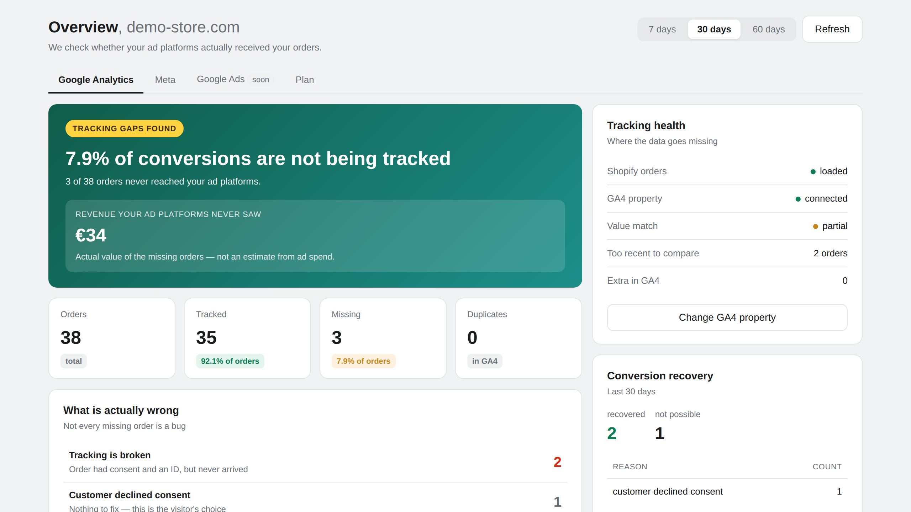

# TrackGap

Checks Shopify orders against what GA4, Meta and Google Ads actually recorded, and shows which orders went missing and why.

**Status:** Built and shipped as a Shopify app in 2026, now retired; source published as a portfolio project.



## The problem

A Shopify merchant sees one number of orders in Shopify, another number of purchases in GA4, and yet other conversion counts in Meta and Google Ads. Some of the difference is expected (visitors who decline consent, ad blockers, attribution windows). Some of it means tracking is broken: a tag removed during a theme change, a duplicate purchase event, a consent banner that never fires the tag, a conversion action that has been silent for weeks.

From the numbers alone, a merchant cannot tell which case they are in. TrackGap answers that per order: which orders never reached the analytics or ad platform, which were recorded twice, and where along the chain the event was lost.

## What it does

- Reads orders server-side from the Shopify Admin API (order ID, totals, timestamps, UTM parameters only; no customer name, email, address or phone).
- Reads GA4 purchase transactions through the merchant's own Google OAuth (read-only scope) and matches them to orders by transaction ID.
- Runs its own Shopify web pixel as an independent witness, so a missing order can be classified as "the purchase event never fired in the browser" or "it fired but never arrived in GA4".
- Compares daily Meta purchase conversions (Insights API, aggregates only) with daily Shopify orders.
- Flags Google Ads campaigns (via GA4 Ads dimensions) that spend money and get clicks but record no transactions while the store keeps selling.
- Optionally recovers missing purchases server-side from the `orders/create` webhook: GA4 Measurement Protocol (only with recorded consent and a captured GA4 client ID, skipped if the transaction is already in GA4) and Meta Conversions API (order number as `event_id` for deduplication, only with a usable identifier, within Meta's 7-day window).
- Runs checks on a schedule (weekly on the free plan, daily on paid plans), stores history, detects regressions and sends one grouped email alert per check.
- Tells the merchant explicitly when it can no longer see the data (expired Shopify token, revoked Google access) instead of silently showing the last cached result.
- Billing through the Shopify Billing API (Free / Starter / Growth / Pro, monthly or annual).

## Checks performed

| Finding | How it is detected |
|---|---|
| Missing orders | Shopify order ID has no matching GA4 transaction in the compared window |
| Cause: never fired | Missing in GA4 and the TrackGap pixel saw no purchase either |
| Cause: delivery broken | The pixel saw the purchase in the browser, GA4 did not record it |
| Cause: consent declined / no identifier | No consent or no GA4 client ID captured, so nothing is fixable or recoverable |
| Duplicate transactions | The same transaction ID recorded more than once in GA4 |
| Ghost transactions | Transactions in GA4 with no matching order in the store |
| Revenue mismatch | Per-order values compared; constant offsets (shipping) and constant ratios (VAT rates) are reported as notes, random divergence as a finding |
| Cardinality | GA4 `(other)` row or truncated reports that would make the comparison unreliable |
| Meta gap | Daily Meta purchase count vs daily Shopify orders for the selected action type |
| Google Ads silent campaign | Spend and clicks with zero transactions while Shopify orders keep coming in |
| Regressions over time | Missing rate spike, new duplicates, value matching broke, pixel went silent |

## Architecture

```
                 Shopify store (storefront + checkout)
                    |                          |
     web pixel (strict sandbox)          orders/create, orders/updated,
     reads _ga cookies, click IDs,       app/uninstalled, GDPR webhooks
     consent state                       (HMAC verified)
                    |                          |
                    v                          v
   /pixel/event or app proxy  ----->  TrackGap server (Node.js, no framework)
                                       - Shopify OAuth + token exchange
                                       - session token (JWT) auth for the embedded UI
                                       - reconcile engine
                                       - scheduler + alerts (SMTP)
                                       - SQLite, tokens encrypted with AES-256-GCM
                                           |         |            |
                         Shopify Admin API     GA4 Data/Admin API    Meta Graph API
                         (orders, billing,     (transactions,        (Insights,
                          web pixel)            Ads dimensions)       Conversions API)
                                           |
                                           v
                    Embedded admin UI (App Bridge, single HTML page)
```

Data flow for one check:

1. Fetch the last N days of orders from the Shopify Admin API and store the minimal fields in SQLite.
2. Fetch GA4 transactions for the same window from the merchant's selected property.
3. Load pixel events and identities (GA4 client ID, session ID, consent) linked to each order through the checkout token and order note attributes.
4. `reconcile()` matches orders to transactions, classifies every missing order by layer, and analyses value differences.
5. The result is cached, written to history, compared with previous runs for regressions, and any alerts are queued and sent as a single email.

## Tech stack

- **Server:** Node.js (ES modules), plain `node:http`, no web framework
- **Storage:** SQLite via `better-sqlite3`, versioned schema migrations, access and refresh tokens encrypted at rest with AES-256-GCM
- **Shopify:** Admin GraphQL API (2026-07), OAuth and token exchange, App Bridge session tokens, Billing API, app proxy, web pixel extension, GDPR compliance webhooks
- **Google:** GA4 Data API and Admin API (read-only OAuth), Measurement Protocol
- **Meta:** Marketing API Insights, Conversions API, Facebook Login for Business
- **Mail:** small built-in SMTP client with STARTTLS and AUTH
- **UI:** single static HTML page served inside the Shopify admin iframe
- **Tests:** `node:test`, including a loopback SMTP sink to test real alert delivery
- **Deployment (original):** a single VPS, Caddy for TLS, systemd service

## Repository layout

```
app/                     server and all backend modules
  server.mjs             HTTP routes, webhooks, OAuth callbacks
  reconcile.mjs          comparison engine
  shopify.mjs            Shopify OAuth, Admin API, HMAC and proxy signature checks
  ga4.mjs, ads.mjs       GA4 connector and Google Ads analysis over GA4
  meta.mjs, meta_oauth.mjs  Meta connector
  pixel.mjs, backfill.mjs   pixel events, identity merge, conversion recovery
  monitor.mjs, scheduler.mjs, alerts.mjs, smtp.mjs  scheduled checks and alerts
  billing.mjs            Shopify Billing plans and subscription state
  db.mjs                 schema, migrations, encryption
  ui.html, landing.html, privacy.html, terms.html
  review_e2e.mjs         read-only end-to-end checks against a running instance
  test/                  unit and integration tests
extensions/trackgap-pixel/  Shopify web pixel extension
assets/                  icons and screenshots (generated from demo data)
deploy/                  example Caddy and systemd configuration
docs/                    API access documentation written for Google Ads review
shopify.app.toml         Shopify app configuration (placeholders)
```

Code comments are mostly in Slovak; they record why a decision was made and which bug a guard prevents.

## Local setup

Requirements: Node.js 22.9 or newer, a Shopify Partner account with a development store, and a Google Cloud OAuth client if you want the GA4 comparison.

```bash
cp .env.example .env          # fill in SHOPIFY_API_KEY, SHOPIFY_API_SECRET, TRACKGAP_APP_URL, ...
cd app
npm install
npm test                      # runs without any real credentials
npm start                     # listens on 127.0.0.1:$PORT (default 9310)
```

To install it in a development store:

1. Create an app in the Shopify Partner Dashboard and put its client ID into `shopify.app.toml`.
2. Replace `trackgap.example.com` in `shopify.app.toml` with your public HTTPS URL (a tunnel works for development) and set the same value as `TRACKGAP_APP_URL`.
3. From the repository root: `npm install`, then `npx shopify app deploy` to push the configuration and the web pixel extension.
4. Open `https://<your-app-url>/auth?shop=<your-dev-store>.myshopify.com` to install.

For production, see `deploy/Caddyfile.example` and `deploy/trackgap.service.example`. The SQLite database and its encryption key are created in `TRACKGAP_DATA` (default `./data`) on first start.

## Privacy

TrackGap requested Protected Customer Data level 1 only. It stores order IDs, amounts, timestamps, UTM parameters, the GA4 client ID and consent state, and never stores names, emails, addresses or phone numbers. The web pixel runs only for visitors who granted analytics and marketing consent (enforced by Shopify's Customer Privacy API), and GA4 recovery is skipped when consent is denied or unknown. GDPR webhooks (`customers/data_request`, `customers/redact`, `shop/redact`) are implemented, and tokens are deleted on uninstall.

## Author

Karol Bolgár, [NullLogic s.r.o.](https://nulllogic.eu)

## License

MIT, see [LICENSE](LICENSE).
